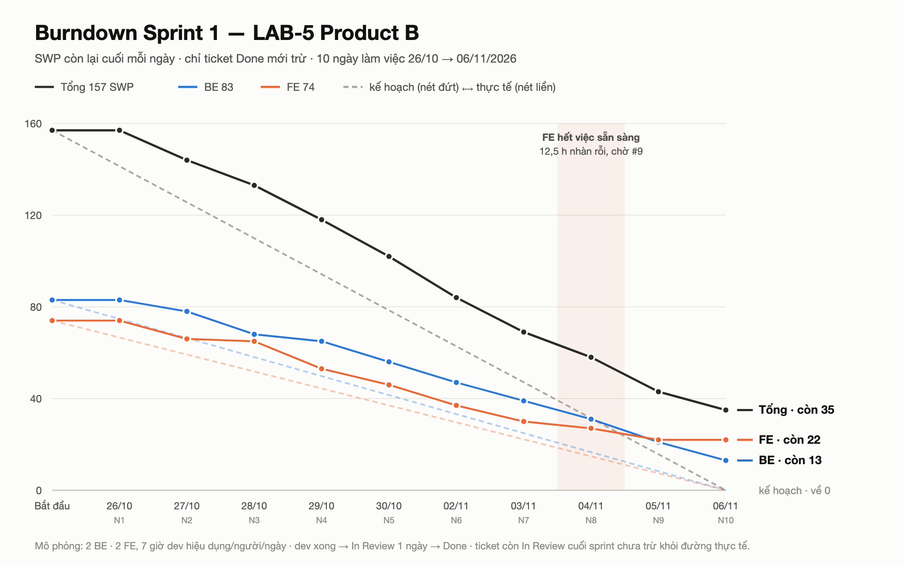

# Progress report — Sprint 1 (giả lập)

## Phần 1 — Đầu file

**Lập ngày 25/10/2026.** Bản HTML đọc bằng trình duyệt:
[`261025-GH-buoc-9-progress-report.html`](reports/261025-GH-buoc-9-progress-report.html) — mở thẳng
được, không cần chạy server. Mọi con số về điểm và giờ lấy từ [`estimate.md`](estimate.md).

### Phạm vi và thời gian

- **Tên Iteration trên Project:** `Sprint 1`, bắt đầu 26/10/2026, kéo dài hai tuần.
- **Khoảng thời gian tôi mô phỏng:** từ thứ Hai **26/10** đến thứ Sáu **06/11/2026**, đúng **10
  ngày làm việc**. Sprint đóng sổ Chủ nhật 08/11.
- **Khối lượng nhận vào sprint:** 45 dev task, tổng **157 SWP**, quy ra 266,9 giờ. Chia hai vai:
  back-end 21 ticket (83 SWP), front-end 24 ticket (74 SWP).
- **Đội giả lập:** 2 back-end, 2 front-end, 1 QA. Riêng việc của QA không nằm trên board — lý do
  và hệ quả tôi ghi ở rủi ro R2.

### Luật mô phỏng

Trạng thái từng ngày không được gán thủ công. Tôi dựng một bộ xếp lịch chạy trên đồ thị phụ
thuộc, theo bốn luật sau:

- **Sức làm việc hiệu dụng: 7 giờ mỗi người mỗi ngày**, không phải 8. Một giờ trừ cho họp, review
  chéo và chi phí chuyển việc.
- **Một ticket do một người đảm nhiệm**, không chia nhỏ giữa hai người.
- **Hoàn thành code chưa tính là xong.** Ticket phải qua một ngày ở trạng thái chờ review rồi mới
  chuyển `Done`.
- **Ràng buộc phụ thuộc được tôn trọng tuyệt đối**: một ticket chỉ vào hàng chờ khi mọi ticket
  chặn nó đã `Done`.

Thứ tự phụ thuộc tôi lấy từ `BAN-GIAO` mục 3: migration nền phải xong trước thì mọi thứ mới chạy
được; hàm tính giờ lái là hàm thuần nên làm song song được; API route cần migration; màn SCR-28
cần API. Riêng `#286` mở menu SCR-19 phải xong sớm nhất — chưa có nó thì vào `/routes` trả 404 và
cả epic E01 không nghiệm thu được.

### Hai lưu ý về dữ liệu

- **Bước này tôi chỉ ghi một trường duy nhất lên board: `Status`.** Điểm SWP, giờ ước lượng và
  sprint giữ nguyên như đã chốt ở bước 8, không đụng tới. Mỗi lần đổi trạng thái tôi đẩy lên
  Project theo đúng ngày của nó, nên mở lịch sử board ra là đọc lại được diễn biến từng ngày.
- **Chia vai có sửa so với bước 8.** Bản `estimate.md` đầu tiên xếp `#285` và `#286` vào
  front-end. Soát lại thì bản rã gốc ghi cả hai là việc back-end, và mã ticket trên board cũng là
  `E12-ST-BE-02` và `E12-ST-BE-03`. Tôi đã trả chúng về back-end. Tổng sprint không đổi — vẫn 45
  ticket, 157 SWP — chỉ ranh giới giữa hai vai dịch đi: back-end từ 19 lên 21 ticket, front-end từ
  26 xuống 24.

---

## Phần 2 — Trạng thái cuối sprint

| Trạng thái | Số issue | Tổng SWP | Ghi chú |
|---|---:|---:|---|
| `Done` | 37 | 122 | 78% điểm đã cam kết |
| `In Review` | 3 | 14 | `#10` dải nhiệt xe ⟷ hàng · `#11` đơn chưa phân công · `#14` form A — dev xong N9, chưa kịp merge |
| `In Progress` | 2 | 12 | `#34` khối C bốn dòng ngưỡng (**còn 6,6 giờ**, chỉ bắt đầu được từ N10) · `#277` bộ đếm cảnh báo (còn 3,1 giờ) |
| `Blocked` | 1 | 3 | `#54` soát 18 chuỗi Nhật — đội không có người bản ngữ |
| `Todo` | 2 | 6 | `#15` khối đơn chưa phân công (chờ `#11`) · `#16` soát 22 chuỗi Nhật (chờ `#15`) |
| **Tổng** | **45** | **157** | |

### Ba cách đọc cùng một kết quả

- **Tỉ lệ hoàn thành: 78%** — 122 trên 157 điểm đã đóng. Đây là con số dùng để báo cáo tiến độ.
- **Tỉ lệ hoàn thành phần lập trình: 86,6%** — 136 trên 157 điểm, tính thêm ba ticket đã xong code
  nhưng còn ở trạng thái chờ review. Chênh lệch giữa hai tỉ lệ chính là độ trễ của khâu review.
- **Tỉ lệ giờ đã sử dụng: 90,6%** — 241,9 trên 266,9 giờ dự kiến, tức chỉ còn **25 giờ công chưa
  thực hiện**.

Ba tỉ lệ lệch nhau đáng kể: **bảng điểm hụt 22% trong khi công thực tế chỉ hụt 9,4%.** Nguyên nhân
là kích thước ticket quá lớn. Riêng `#34` mang 8 điểm, ba ticket chờ review mang thêm 14 điểm, cả
bốn đều đã hoàn thành phần code. Một ticket thiếu vài giờ vẫn kéo trọn số điểm của nó sang sprint
sau — đây là hạn chế của cách đo theo điểm khi ticket không được rã đủ nhỏ.

### Mục tiêu sprint chưa nghiệm thu được

Sprint đặt mục tiêu hoàn thành ba phần: dựng tuyến giao hàng (E01), luật giờ lái (E02) và nền
tảng dùng chung (E12). Điểm vướng là `#34` — khối màn hình nơi người điều phối đọc bốn dòng kết
quả kiểm giờ lái rồi bấm nút công bố tuyến.

Thiếu khối này, SCR-28 cho phép dựng tuyến nhưng không cho thao tác tiếp trên tuyến vừa dựng. Đó
đúng là tình huống bản thiết kế LAB-4 tuyên bố không chấp nhận: dẫn người dùng đi hết một luồng
rồi mới báo là ngõ cụt (xem `PREMISE` mục 3, dòng `V-1`).

---

## Phần 3 — Burndown

Đường kế hoạch vẽ đơn giản: 157 điểm chia đều cho 10 ngày làm việc. Tôi tách riêng đường back-end
(83 điểm) và front-end (74 điểm), vì hai vai này không gánh việc hộ nhau được. Chỉ ticket đã đóng
hẳn mới được trừ khỏi đường thực tế.

**Đường thực tế nằm trên đường kế hoạch suốt cả sprint**, và sang tuần thứ hai thì hai vai tách
hẳn nhau. Bốn lý do, xếp theo mức đóng góp:

#### Nguyên nhân 1 — front-end hết việc từ giữa sprint (chiếm phần lớn độ lệch)

Hết ngày thứ 5, front-end đã làm xong toàn bộ 12 ticket vay từ các epic khác, và xong luôn phần
nền tảng của mình. Từ ngày thứ 6 trở đi, ba ticket còn lại đều phải chờ back-end: màn form A chờ
API route, khối đơn chưa phân công chờ hàm lấy danh sách đơn, khối bốn dòng ngưỡng chờ hợp đồng
dữ liệu.

**Ngày thứ 8 là đáy — front-end không có việc 12,5 trên 14 giờ**, đúng chỗ dải màu trên biểu đồ. Tính
cả sprint, front-end nhàn rỗi **36,1 giờ trên tổng 140 giờ**. Tức là **hơn một phần tư sức chứa
của vai này mất vì chờ**, không phải vì thiếu việc trên board.

#### Nguyên nhân 2 — back-end kín việc gần như tuyệt đối

Suốt 10 ngày back-end chỉ có **2 giờ** không có việc. Nếu cộng gộp hai vai thì tổng nhàn rỗi là 38,1 trên
280 giờ, tương đương 13,6%. Nhưng con số gộp che mất điểm cốt lõi: gần như toàn bộ phần
không có việc dồn vào một vai.

Đây là biểu hiện cụ thể của rủi ro R5: khối lượng việc trên board nghiêng 64% về back-end trong
khi đội chia đôi 50/50. Trước sprint này đó mới là một nhận định; nay đã có số giờ đo được.

#### Nguyên nhân 3 — hai mắt xích cuối chuỗi phụ thuộc hoàn thành quá muộn

API route đóng sáng ngày thứ 9. Hợp đồng dữ liệu `check_result` đóng sáng ngày thứ 10. Mà khối bốn
dòng ngưỡng phụ thuộc vào hợp đồng đó, lại cần tới 13,6 giờ — chỉ còn một ngày thì làm được 7 giờ,
thiếu 6,6.

Cùng lúc đó, khối đơn chưa phân công không bao giờ đủ điều kiện để bắt đầu, vì ticket chặn nó chỉ
kịp vào trạng thái chờ review. Kéo theo ticket soát chuỗi tiếng Nhật cũng không tới lượt.

Nguyên nhân gốc nằm ở **cách rã ticket, không phải ở cách xếp lịch**: khối bốn dòng ngưỡng là
ticket front-end lớn nhất board nhưng lại nằm ở mắt cuối một chuỗi năm mắt phụ thuộc.

#### Nguyên nhân 4 — độ trễ một ngày của khâu review, lặp lại suốt sprint

Ngày đầu tiên burndown không trừ được điểm nào, dù sáu ticket đã code xong trong ngày hôm đó —
tất cả đều nằm chờ review tới sáng hôm sau. Đường thực tế vì vậy khởi hành muộn một ngày và giữ
nguyên khoảng cách đó tới cuối. Hết sprint vẫn còn 14 điểm kẹt ở chỗ chờ review.

Đây là đặc tính của **cách đo**, không phải trượt tiến độ: điểm chỉ được trừ khi ticket đóng hẳn.

#### Ghi chú thêm — tỉ lệ "dùng 83% sức chứa" không phản ánh đúng thực tế

266,9 giờ trên sức chứa danh nghĩa 320 giờ (4 người × 8 giờ × 10 ngày) cho tỉ lệ 83%, tạo cảm
giác còn dư chỗ. Tính trên sức chứa **hiệu dụng** — 280 giờ, sau khi trừ họp và review — tỉ lệ
thật là **95%**. Sprint được lên kế hoạch với gần như không có đệm. Chi tiết ở rủi ro R7.

#### Phần đạt kế hoạch

Ticket mở menu SCR-19 hoàn thành ngay ngày đầu và đóng sáng ngày thứ hai, nhờ đó đường dẫn
`/routes` trả về trang thật thay vì lỗi 404 từ ngày thứ hai, và tiêu chí nghiệm thu đầu tiên của
epic dựng tuyến có đường thực hiện. Hai nhánh nền — migration cơ sở dữ liệu và hàm tính giờ lái —
chạy song song đúng thiết kế, không mắt nào trễ.

---

## Phần 4 — Rủi ro trễ

Bảng rủi ro dựng từ ba nguồn. Thứ nhất là kết quả mô phỏng vừa trình bày ở trên. Thứ hai là một
lượt rà soát theo năm góc chuyên môn — kiến trúc, bảo mật, hiệu năng, trải nghiệm người dùng và
phản biện giả định — mỗi góc kết luận độc lập trước khi đối chiếu với nhau. Thứ ba là bốn khoảng
hụt đã xác định từ bước ước lượng, ghi trong `estimate.md` mục 2 và mục 5.

**Đánh giá chung: cần thận trọng, chưa tới mức phải dừng.** Mười rủi ro dưới đây xếp theo mức
nghiêm trọng giảm dần.

| Rủi ro | Issue | Ảnh hưởng tới mốc nào | Hành động | Ai làm, khi nào |
|---|---|---|---|---|
| **R1 — Mục tiêu Sprint 1 không nghiệm thu được.** `#34` còn 6,6 giờ nhưng nó là chỗ bấm nút công bố. SCR-28 dựng được tuyến mà không hành động được | `#34` | `AC-28-37` (hiện khoảng vi phạm chính xác) · `AC-28-45` (bật nút `公開へ進む`) · demo cuối Sprint 1 | Tách `#34` làm hai: bốn dòng ngưỡng **chỉ đọc** đóng trước, phần gating nút công bố tách thành ticket riêng. 8 SWP ở mắt cuối chuỗi là hạt quá to cho một sprint | FE-1 · ngày đầu Sprint 2 (09/11) |
| **R2 — Board KHÔNG có việc QA, burndown chỉ vẽ được việc dev.** QA cần thang điểm riêng nên bài lab không rã cho QA. 142,6 ngày công là **công dev thuần** | cả board — 0 ticket QA trong 307 item | Mọi mốc nghiệm thu. LAB-1: **92 ngày QA trên 354 ngày dev** của chính nó cho cùng phạm vi ⇒ tỉ lệ **QA : dev = 26%**; áp lên 142,6 ra **~37 ngày công QA** nằm ngoài con số đó | Không trích 142,6 ngày ở bất kỳ đâu mà không kèm câu "chưa tính ~37 ngày QA (+26%)". **Đừng cộng thẳng 92 vào 142,6** — 92 thuộc thang phạm vi rộng hơn của LAB-1. Rã việc QA bằng thang đo riêng trước khi con số này đi ra ngoài | PM + QA lead · trước khi chốt báo giá |
| **R3 — Không ticket nào mang công sửa bug.** Việc làm ở Sprint 1 sẽ sinh bug khi QA test tới, công sửa vẫn phải trả nhưng hiện không ticket nào gánh | cả board — 0 nhãn `qa-bug`/`uat-bug`/`production-bug`, 0 tiêu đề `[BUG]`, 0 issue loại bug | Sức chứa từ Sprint 2 trở đi. LAB-1 chừa **41 ngày công BE+FE** cho nhóm kiểm thử hệ thống, tức **~12% công dev** | Chừa 12% sức chứa mỗi sprint từ Sprint 2: nhận ~83 SWP/vai thay vì 94. Hoặc sinh ticket mẫu `08-qa-bug` khi QA báo — số thật hơn nhưng không lên kế hoạch trước được. ⚠ 41 ngày của LAB-1 phần lớn là hỗ trợ UAT, kiểm tải và tinh chỉnh, nên 12% chỉ là số thay thế tạm | PM · khi cắt Sprint 2 |
| **R4 — E12 nền tảng chung nghi rã thiếu 90%.** LAB-1 cho 65 ngày công BE+FE, board chỉ 32 SWP tức 6,8 ngày | E12 `#273`–`#293` | Mọi epic sau đều đứng trên E12. **Nếu sprint nào trượt ở nhánh nền thì đây là nguyên nhân đáng ngờ nhất** | Sprint 1 đóng được 9 trong 11 ticket E12 (`#277` còn dở), không sự cố kỹ thuật nào — nhưng đó là bằng chứng **yếu**: nó chỉ nói về phần *đã* rã, không nói gì về 90% còn thiếu. Soi lại backlog E12 đối chiếu 65 ngày của LAB-1 | BA + tech lead · trong Sprint 2, trước khi cắt Sprint 3 |
| **R5 — Board lệch 64% BE / 36% FE trong khi đội 50/50.** BE cần 5 sprint, FE chỉ cần 3 | cả board | Mọi sprint. Sprint 1 đã đo được thành giờ: **BE nhàn rỗi 2,0 h, FE nhàn rỗi 36,1 h** trên cùng 140 giờ sức chứa | Chọn một: đổi tỉ lệ sang 3 BE / 1 FE từ Sprint 3 (va với kế hoạch người của LAB-1, phải báo khách), **hoặc** bổ sung E12 cho đủ — nền tảng chung là nơi sinh việc FE nhiều nhất. R4 và R5 là hai triệu chứng của một nguyên nhân | PM · quyết trước Sprint 3 |
| **R6 — Hợp đồng `check_result` giao tay giữa hai vai vào ngày cuối.** `#32` chốt hình dạng `V-3`, `#34` tiêu thụ nó. Hợp đồng chạy qua ranh giới BE ⟷ FE ở N10 | `#32` → `#34` | E03 SCR-29 ở Sprint 2 cũng đọc `check_result` — cùng một hợp đồng, cùng một chỗ vỡ | Tách hợp đồng khỏi phần cài đặt: chốt kiểu TypeScript dùng chung + một bộ fixture JSON ngay N1 Sprint 2, FE dựng trên fixture mà không chờ BE code xong | BE-1 + FE-1 · N1 Sprint 2 |
| **R7 — Sức chứa 83% đo sai mẫu số, và tỉ lệ 1,7 giờ/SWP là lập luận vòng tròn.** 266,9/320 giờ danh nghĩa = 83%, nhưng 266,9/280 giờ hiệu dụng = 95%. Thêm nữa, tỉ lệ 1,7 rút ra từ đúng E01+E02 — đúng cặp epic sprint này chạy | — | Cách cắt mọi sprint sau. Sprint 2 trở đi sẽ cắt quá tay nếu vẫn lấy 94 SWP/vai | Cắt sprint theo 7 giờ/người/ngày: trần thực tế ~82 SWP/vai, không phải 94. Khi sang epic ngoài E01/E02, đo lại tỉ lệ bằng số thật của sprint đó thay vì giữ 1,7 | PM · khi cắt Sprint 2 |
| **R8 — `#9` kiểm quyền ba lớp không có đường nghiệm thu độc lập.** Đây là ticket an-toàn-trọng-yếu duy nhất của sprint, và không QA nào soát nó (xem R2) | `#9` | An toàn truy cập của cả 15 màn | Bắt buộc review chéo BE-2 cộng một bộ test quyền tự động chạy trong CI trước khi đóng. Không đóng `#9` bằng lời khai của người viết nó | BE-2 · trong Sprint 2 |
| **R9 — Đội không có người bản ngữ tiếng Nhật.** 40 chuỗi Nhật mới của SCR-28 và SCR-29 không ai soát được | `#54` (Blocked) · `#16` (chưa tới lượt) | Nghiệm thu phần chữ của SCR-28 và SCR-29. Với khách Nhật đây là loại lỗi dễ thấy nhất và rẻ nhất để sửa | Đặt lịch một người bản ngữ ngoài đội, gộp 40 chuỗi vào một lượt soát. Không thu xếp được thì hạ xuống rủi ro chấp nhận và ghi vào biên bản sprint review | PM · trước 09/11 |
| **R10 — 12 ticket FE vay từ E03, E06, E07 không thuộc mục tiêu Sprint 1.** Kéo vào chỉ để lấp sức chứa front-end. Chúng trượt thì **không chặn ai** | `#50` `#51` `#52` `#54` `#83` `#84` `#111` `#112` `#113` `#121` `#122` `#123` — 33 SWP | **Không mốc nào.** Phải tách khỏi đường tới hạn khi đánh giá — trừ `#54`, nó nằm trong R9 vì lý do khác | Báo tải FE bằng **hai** con số: có việc vay 74/94 = 79%, không có việc vay **41/94 = 44%**. Con số thứ hai mới là tình trạng thật, và nó chính là R5 | PM · mỗi lần báo tiến độ |

### Hai đánh đổi trong phần đánh giá rủi ro

Hai quyết định dưới đây có lập luận hợp lý ở cả hai phía. Tôi ghi lại cả hai hướng cùng căn cứ của
lựa chọn cuối, để sprint sau có thể xét lại nếu bối cảnh đổi.

#### Đánh đổi 1 — có tiếp tục vay việc từ epic khác để lấp sức chứa front-end không

**Lý lẽ giữ cách vay.** 12 ticket vay từ E03, E06 và E07 đã hấp thụ 33 điểm công việc. Nếu bỏ,
thời gian chờ của front-end tăng từ 36,1 giờ lên khoảng 92 giờ — tức gần hai phần ba sức chứa của
vai này bị bỏ không trong một sprint.

**Lý lẽ bỏ cách vay.** Chính việc vay làm tải front-end trông như 79%, trong khi tải thật tính
theo mục tiêu sprint chỉ là 44%. Con số đẹp che mất một vấn đề ở cấp kế hoạch: khối lượng việc
nghiêng 64% về back-end nhưng đội lại chia đôi. Che đi thì không ai đặt câu hỏi về cơ cấu đội.

**Quyết định.** Giữ cách vay, nhưng từ sprint sau báo cáo tải front-end bằng **hai con số tách
bạch**: tải có tính việc vay, và tải chỉ tính việc thuộc mục tiêu sprint. Vay là biện pháp giảm
lãng phí trước mắt, nó không được phép thay thế việc đo đúng mức mất cân đối. Yêu cầu này ghi ở
rủi ro R10.

#### Đánh đổi 2 — có đưa `#34` lên làm sớm hơn được không

**Lý lẽ đưa lên sớm.** `#34` là khối màn hình quyết định của SCR-28 — nơi người điều phối đọc kết
quả kiểm giờ lái rồi bấm nút công bố. Thiếu nó thì sprint không có gì để nghiệm thu, dù 78% điểm
đã đóng.

**Lý lẽ không đưa lên được.** `#34` phụ thuộc `#32` (hợp đồng dữ liệu `check_result`), mà `#32`
lại phụ thuộc cả bốn ticket tính ngưỡng. Chuỗi phụ thuộc này có thật, không đảo được. Ép làm sớm
chỉ dẫn tới dựng giao diện trên một hợp đồng chưa chốt, rồi phải sửa lại khi hợp đồng ra.

**Quyết định.** Không đổi thứ tự, mà đổi kích thước ticket. `#34` mang 8 điểm — lớn nhất trong
toàn bộ việc front-end — và nằm ở mắt cuối một chuỗi năm mắt; chỉ cần chuỗi trễ một ngày là trọn
8 điểm trượt sang sprint sau. Tách làm hai: phần hiển thị bốn dòng ngưỡng ở chế độ chỉ đọc, và
phần điều kiện bật nút công bố. Hành động này ghi ở rủi ro R1.

### Những điểm còn để mở

- **Sprint 2 chưa được cắt**, hiện mới có hai ticket gán sẵn. Khi cắt phải áp hai điều chỉnh rút
  ra từ sprint này: trần thực tế khoảng 82 điểm mỗi vai thay vì 94, và chừa 12% sức chứa cho công
  sửa lỗi. Phần việc mới mỗi vai nhận được còn khoảng 72 điểm.
- **Mô phỏng quá hai sprint phải giảm sức chứa theo.** Kế hoạch nhân sự của LAB-1 rút front-end
  xuống 1 người từ tháng 01/2027, sau đó còn 0,5. Giữ nguyên 2 người là lệch so với kế hoạch đã
  gửi khách.
- **Lịch mô phỏng lệch hai tháng so với kế hoạch gốc.** Sprint 1 ở đây bắt đầu 26/10/2026, trong
  khi theo LAB-1 thì thời điểm đó dự án vẫn đang ở giai đoạn thiết kế cơ bản; tháng bắt đầu xây
  dựng là 12/2026. Đây là mốc giả lập phục vụ bài lab, không phải lịch triển khai thật.
